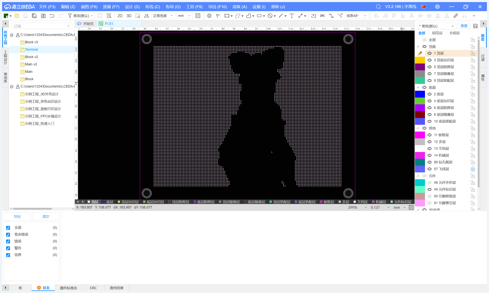

# PCB 逐帧动画管线

把任意视频逐帧映射成 PCB 焊盘阵列，在嘉立创EDA 专业版里真实渲染，再截图合成回视频。

输出的不是贴图或特效合成——**每一帧的每一个点都是编辑器里真实存在的焊盘**，动画就是这些焊盘的增删。

## 样例

《Bad Apple!!》，6573 帧、128 × 96 栅格、单帧最多 8875 个焊盘。



| 文件 | 体积 | 说明 |
|---|---|---|
| `deliverables/badapple_pcb_audio_2582x1550_30fps.mp4` | 51.2 MB | 带音轨 |
| `deliverables/badapple_pcb_pure_2582x1550_30fps.mp4` | 49.2 MB | 无音轨，视频流与前者逐帧一致 |

- H.264 High / Level 5.0，**2582 × 1550**，yuv420p，30 fps 恒定，6573 帧，**219.10 秒**
- 音频 AAC-LC 44.1 kHz 立体声，64 kbps；总码率 1.8 Mbps
- 宽高比 1.666（5:3）来自 EDA 窗口的原生比例，不是 16:9

## 原理

1. **取帧** — 源视频导出逐帧 PNG。
2. **降采样二值化** — Lanczos 缩到栅格尺寸，阈值 128 转黑白。尺寸取 4:1 整除可避免相位偏移。
3. **坐标映射** — 板框尺寸固定，栅格居中内缩，换算出每格的焊盘坐标。
4. **铺焊盘** — 在**同一块** PCB 上按坐标创建圆形 SMD 焊盘。
5. **差分更新** — 与上一帧比较，只增删变化的焊盘，然后截整窗。
6. **拼接** — ffmpeg 按源帧率编码，需要时混入音轨。

### 为什么必须差分

| 方式 | 单帧 | 6573 帧全片 |
|---|---|---|
| 每帧清空重铺（~7773 个） | ~6.0 s | 约 11 小时 |
| 差分增删（每帧 50–300 个） | **0.86 s** | **1 小时 34 分** |

重铺还会让每一帧经过一次“板上空无一物”的中间态，截图撞上就会闪。

### 三个关键点

- **Y 轴要翻** — EDA 的 y 向上增大。按行号递增直接算会让整幅画上下颠倒，必须 `y = 顶边 − 行号 × 栅距`。
- **极性决定观感** — 白场点亮焊盘还是黑场点亮，得到的是两种完全不同的东西。样例用的是白场点亮（与源片明暗一致）。
- **截图方式** — `PrintWindow` 抓整窗，窗口被遮挡也能截，且系统光标不入画。代价是进程必须先声明 DPI 感知（否则窗口尺寸被系统虚拟化，右侧面板会被裁掉），且 EDA 失焦时会叠一层约 ×0.803 的暗色蒙版，需要后期还原。

## 当前配置

| 项 | 值 |
|---|---|
| 板框 | 3800 × 2968 mil（96.5 × 75.4 mm） |
| 栅格 | 128 × 96 = 12288 格 |
| 内缩 | 250 mil |
| 栅距 | 25.98 mil（0.66 mm） |
| 焊盘 | Ø12.99 mil 圆形 SMD |
| 安装孔 | 4 个，内缩 120 / 半径 90 |

## 目录

```
├── deliverables/   成片（音频版 / 纯视频版）
├── source/         源片与导出的逐帧 PNG
├── driver/         渲染管线
│   ├── eda.py            桥接客户端
│   ├── layout.py         板框 → 栅格布局
│   ├── board.py          安装孔
│   ├── driver.py         取帧、降采样、窗口截图
│   ├── render_one.py     单帧整体重铺
│   ├── run_frames.py     逐帧差分渲染 + 截图
│   ├── extract_frames.py 源片导出逐帧
│   └── fix_dim.py        失焦暗帧还原
├── frames/         渲染结果（3.82 GB，不入库）
└── frame120_demo.png
```

## 环境

- Windows + 嘉立创EDA 专业版 **V3.2.186**
- Node.js 18+（跑官方桥接服务）
- Python 3.13，`numpy` `pillow` `pywin32`
- ffmpeg

桥接用 [`easyeda-api`](https://www.npmjs.com/package/@jlceda/easyeda-api) 官方 skill 自带的 `scripts/bridge-server.mjs`（作者 JLCEDA，v1.1.69）。

## 运行

```bash
# 1. 导出逐帧
python driver/extract_frames.py

# 2. 启动桥接，并在 EDA 里打开 PCB 文档
node "$USERPROFILE/.workbuddy/skills/easyeda-api/scripts/bridge-server.mjs"

# 3. 逐帧渲染
python driver/run_frames.py --reset --holes -n 6573 -o frames/

# 4. 编码
ffmpeg -framerate 30 -i frames/%05d.png \
       -c:v libx264 -crf 18 -preset slow -pix_fmt yuv420p \
       -movflags +faststart out.mp4
```

渲染开始前确认：EDA 窗口**未最小化**、鼠标停在画布外、过程中不要点击任务栏图标。

## 换一个片子

1. 换 `source/` 里的源片，重跑 `extract_frames.py`
2. 改 `driver/layout.py` 的 `COLS` / `ROWS`（栅格密度决定清晰度，也决定单帧焊盘数）
3. 板框尺寸由 EDA 里画好的轮廓决定，`layout.py` 会自动读取并居中内缩
4. 渲染前用 `driver/render_one.py <帧号> smd` 出一帧样张确认构图

## 许可

见 [LICENSE](LICENSE)。样例片源版权归原作者所有，本项目仅为技术演示。
